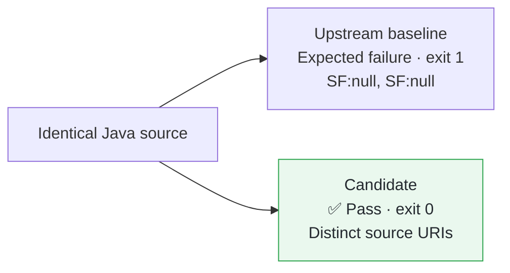

## Fix

Pathless sources produce `SF:null`, giving different sources the same LCOV identifier.
Use the source URI instead, with the existing content/name-derived URI as the fallback for an explicitly empty URI.
File-backed paths retain precedence; regressions and documentation cover these cases.

**[This PR’s Validation and Review](https://graalvm.elide.dev/contributions/contribution-first-lcov)**

## Validation

Pretested in [fork #225](https://github.com/elide-dev/graal/pull/225): upstream [`a369308fb9f4`](https://github.com/oracle/graal/commit/a369308fb9f4fbed7746caf33c87eb8f3a61b613) → candidate [`3c92f7b36f8`](https://github.com/elide-dev/graal/commit/3c92f7b36f8968bbb805448b422bde7f769ef080).
[CI head `37ec31cb23d0`](https://github.com/elide-dev/graal/commit/37ec31cb23d01de316b898a242f4c7adca0e7d95) has byte-identical affected source, tests, and documentation; only fork CI scaffolding differs.

[Reproduction Commands](https://github.com/elide-dev/graal/blob/b4fe11971b7cc5a5edc5fd0e7c75aa24dd600388/pipeline/reproducers/lcov/README.md) · [Source ZIP](https://github.com/elide-dev/graal/raw/b4fe11971b7cc5a5edc5fd0e7c75aa24dd600388/pipeline/reproducers/archives/lcov.zip) · [SHA-256 Manifest](https://github.com/elide-dev/graal/blob/b4fe11971b7cc5a5edc5fd0e7c75aa24dd600388/pipeline/reproducers/archives/manifest.json)

| Check | Verified Result | Evidence |
| --- | --- | --- |
| Fork CI | ✅ All 9 `CoverageTest` tests and checkstyle passed; artifacts inspected | [Run 42560305112](https://github.com/elide-dev/graal/actions/runs/42560305112) |
| Astra AI review and confirmation | ✅ Initial empty-URI defect corrected; original counterexample, LCOV consumer checks, and content/URI edge probes passed | [Finding](https://github.com/elide-dev/graal/blob/b4fe11971b7cc5a5edc5fd0e7c75aa24dd600388/pipeline/reviews/lcov.json) · [Resolution](https://github.com/elide-dev/graal/blob/b4fe11971b7cc5a5edc5fd0e7c75aa24dd600388/pipeline/reviews/lcov-confirmation.json) |

## Scope

CI ran on Linux x86_64, LabsJDK `25.0.5.1+0-jvmci-25.6-b27`, and mx `7.88` ([pin](https://github.com/graalvm/mx/commit/ef054fc6eca1d516820bd040efa3c0a0f6ef1899)).
Review probes used existing builds.
LCOV 2.0-1 consumer checks ignored pre-existing format warnings; URI identifiers do not make source text discoverable by `genhtml`, and shared caller-selected URIs can still merge records.
[Earlier CI attempts](https://github.com/elide-dev/graal/blob/b4fe11971b7cc5a5edc5fd0e7c75aa24dd600388/pipeline/validation/first-cohort.json) remain recorded.
