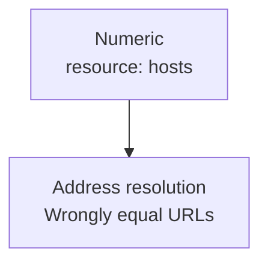
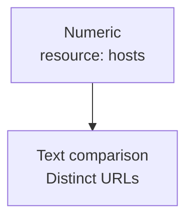

## Summary

Resource URL identity currently passes synthetic hosts to `InetAddress.getByName`.
Numeric aliases such as `127.0.0.1` and `127.1` then compare equal and collapse in sets.
Return `null` from `getHostAddress` to use textual host comparison instead.

**[Elide GraalVM fork dashboard: This PR](https://graalvm.elide.dev/contributions/contribution-first-resource-url)**

**Before** — same path, different resource hosts:

**After:**

These numeric inputs reproduce the bug without DNS.

## Testing

Pretested on the fork at upstream [`a369308fb9f4`](https://github.com/oracle/graal/commit/a369308fb9f4fbed7746caf33c87eb8f3a61b613), with matching source and tests.

- ✅ **Native reproducer:** `equals` and `sameFile` change from true to false; exit `1 → 0`.
- ✅ **Regression tests:** the new identity test ran; `NativeImageResourceTest` reported `OK (24 tests)`; checkstyle passed.
- ✅ **High-power models:** two independent review sessions; native reruns and broader JVM analogue probes passed, with no blocker.

| Evidence | Links |
| --- | --- |
| Reproduce | [Commands](https://github.com/elide-dev/graal/blob/b4fe11971b7cc5a5edc5fd0e7c75aa24dd600388/pipeline/reproducers/resource-url/README.md) · [Source ZIP](https://github.com/elide-dev/graal/raw/b4fe11971b7cc5a5edc5fd0e7c75aa24dd600388/pipeline/reproducers/archives/resource-url.zip) |
| Fork | [#226](https://github.com/elide-dev/graal/pull/226) · [✅ CI](https://github.com/elide-dev/graal/actions/runs/42561385244) |
| Reviews | [Review 1](https://github.com/elide-dev/graal/blob/b4fe11971b7cc5a5edc5fd0e7c75aa24dd600388/pipeline/reviews/resource-url.json) · [Review 2](https://github.com/elide-dev/graal/blob/b4fe11971b7cc5a5edc5fd0e7c75aa24dd600388/pipeline/reviews/resource-url-second.json) |

> The suite total includes skipped/early-return cases; loader-aware/runtime-classpath configurations were not exercised. Review probes used existing builds.
