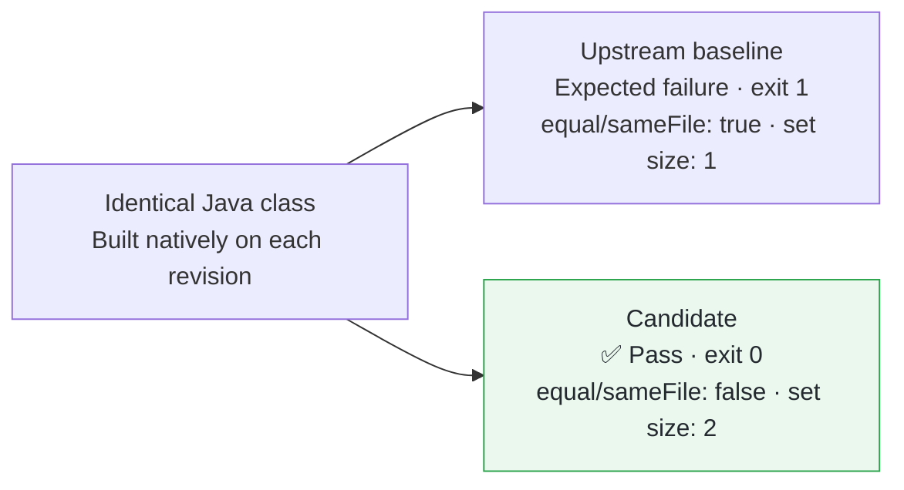

## Fix

URL equality can treat `resource:` hosts as network addresses, making different numeric resource identifiers compare equal and collapse into one set entry.
Return `null` from this handler’s host-address lookup so equality and hashing use the existing textual host comparison.
The numeric-alias regression does not depend on DNS.

**[This PR’s Validation and Review](https://graalvm.elide.dev/contributions/contribution-first-resource-url)**

## Validation

Pretested in [fork #226](https://github.com/elide-dev/graal/pull/226): upstream [`a369308fb9f4`](https://github.com/oracle/graal/commit/a369308fb9f4fbed7746caf33c87eb8f3a61b613) → candidate [`f62ead1c846`](https://github.com/elide-dev/graal/commit/f62ead1c846d842b3abe64afae338cd4971e8315).
[CI head `7aab08f4dd0e`](https://github.com/elide-dev/graal/commit/7aab08f4dd0e2e5a6eddbd99cb37536b1a646cfa) has byte-identical affected source and tests; only fork CI scaffolding differs.

[Reproduction Commands](https://github.com/elide-dev/graal/blob/b4fe11971b7cc5a5edc5fd0e7c75aa24dd600388/pipeline/reproducers/resource-url/README.md) · [Source ZIP](https://github.com/elide-dev/graal/raw/b4fe11971b7cc5a5edc5fd0e7c75aa24dd600388/pipeline/reproducers/archives/resource-url.zip) · [SHA-256 Manifest](https://github.com/elide-dev/graal/blob/b4fe11971b7cc5a5edc5fd0e7c75aa24dd600388/pipeline/reproducers/archives/manifest.json)

| Check | Verified Result | Evidence |
| --- | --- | --- |
| Fork CI | ✅ `resourceURLIdentityUsesAuthority` ran; `NativeImageResourceTest` reported `OK (24 tests)`; checkstyle passed; artifacts inspected | [Run 42561385244](https://github.com/elide-dev/graal/actions/runs/42561385244) |
| Two independent Astra AI reviews | ✅ Native baseline/candidate reruns and broader JVM analogue probes passed; no change-introduced blocker | [First](https://github.com/elide-dev/graal/blob/b4fe11971b7cc5a5edc5fd0e7c75aa24dd600388/pipeline/reviews/resource-url.json) · [Second](https://github.com/elide-dev/graal/blob/b4fe11971b7cc5a5edc5fd0e7c75aa24dd600388/pipeline/reviews/resource-url-second.json) |

## Scope

CI ran on Linux x86_64, LabsJDK `25.0.5.1+0-jvmci-25.6-b27`, and mx `7.88` ([pin](https://github.com/graalvm/mx/commit/ef054fc6eca1d516820bd040efa3c0a0f6ef1899)).
The 24-test aggregate includes assumption-skipped and early-return cases; loader-aware/runtime-classpath configurations remain unqualified.
Reviews used existing native binaries; additional IPv6, case/hash, and cached-address checks used JVM analogues.
Inherited `userInfo` identity behavior remains outside this fix.
[Earlier CI attempts](https://github.com/elide-dev/graal/blob/b4fe11971b7cc5a5edc5fd0e7c75aa24dd600388/pipeline/validation/first-cohort.json) remain recorded.
