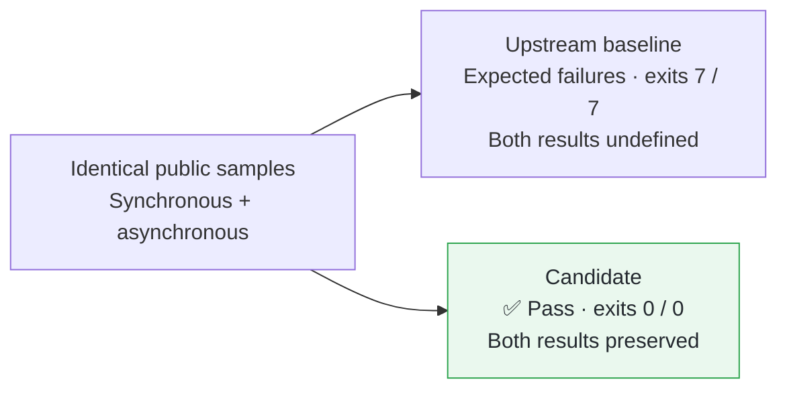

## Fix

Functions containing `using` can return `undefined` instead of their result; asynchronous disposal can also discard a normal completion value after suspension.
Preserve enclosing block flags and retain normal completion values when resuming finally execution, while preserving pending exceptions.

**[This PR’s Validation and Review](https://graalvm.elide.dev/contributions/contribution-first-using-return)**

## Validation

Pretested in [fork #14](https://github.com/elide-dev/graaljs/pull/14): upstream [`934cb7cb826`](https://github.com/oracle/graaljs/commit/934cb7cb826453f687220493bcf08fa386c659aa) → candidate [`639ec40d68f`](https://github.com/elide-dev/graaljs/commit/639ec40d68f4242166b56b2f30d89e767ac197f6), using declared Graal import [`29054f702c3c`](https://github.com/oracle/graal/commit/29054f702c3cd8420cdc927409b7d0f55acddec2).
[CI head `bb912eb10867`](https://github.com/elide-dev/graaljs/commit/bb912eb1086736a404248930f161a7940e8a8041) has byte-identical affected source and tests; only fork CI scaffolding differs.

[Reproduction Commands](https://github.com/elide-dev/graal/blob/b4fe11971b7cc5a5edc5fd0e7c75aa24dd600388/pipeline/reproducers/using-return/README.md) · [Source ZIP](https://github.com/elide-dev/graal/raw/b4fe11971b7cc5a5edc5fd0e7c75aa24dd600388/pipeline/reproducers/archives/using-return.zip) · [SHA-256 Manifest](https://github.com/elide-dev/graal/blob/b4fe11971b7cc5a5edc5fd0e7c75aa24dd600388/pipeline/reproducers/archives/manifest.json)

| Check | Verified Result | Evidence |
| --- | --- | --- |
| Fork CI | ✅ `JSSimpleTestSuite`: `OK (487 tests)`, one ignored; checkstyle passed; public sample bytes and artifacts inspected | [Run 42561388254](https://github.com/elide-dev/graaljs/actions/runs/42561388254) |
| Two independent Astra AI reviews | ✅ 31 + 53 additional runtime assertions and module probes passed; no actionable finding | [First](https://github.com/elide-dev/graal/blob/b4fe11971b7cc5a5edc5fd0e7c75aa24dd600388/pipeline/reviews/using-return.json) · [Second](https://github.com/elide-dev/graal/blob/b4fe11971b7cc5a5edc5fd0e7c75aa24dd600388/pipeline/reviews/using-return-second.json) |

Probes exercised repeated suspension, generator return/throw, disposal-error precedence, labeled control flow, and module ordering/exports.

## Scope

CI ran on Linux x86_64, LabsJDK `25.0.5.1+0-jvmci-25.6-b27`, and mx `7.88` ([pin](https://github.com/graalvm/mx/commit/ef054fc6eca1d516820bd040efa3c0a0f6ef1899)).
Reviews executed existing candidate builds.
These focused checks do not establish Test262 or compiler-stress coverage.
[Earlier CI attempts](https://github.com/elide-dev/graal/blob/b4fe11971b7cc5a5edc5fd0e7c75aa24dd600388/pipeline/validation/first-cohort.json) remain recorded.
