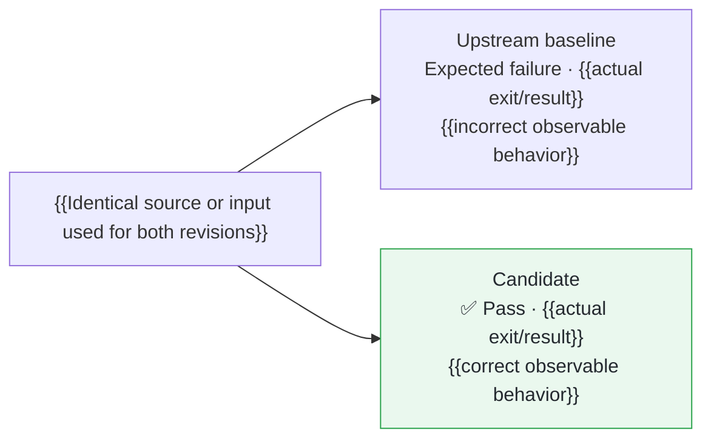

## Fix

{{Concrete input or action}} currently {{incorrect observable result}}.
{{Explain the change and resulting behavior in one or two sentences, naming regressions or documentation only when useful.}}

**[This PR’s Validation and Review]({{PER_PR_DASHBOARD_URL}})**{{DASHBOARD_STATUS_IF_NOT_YET_VERIFIED_LIVE}}

## Validation

Pretested in [fork #{{FORK_PR_NUMBER}}]({{FORK_PR_URL}}): upstream [`{{BASE_SHORT_SHA}}`]({{BASE_COMMIT_URL}}) → candidate [`{{CANDIDATE_SHORT_SHA}}`]({{CANDIDATE_COMMIT_URL}}){{RELEVANT_PINNED_DEPENDENCY_IMPORT}}.
[CI head `{{FORK_HEAD_SHORT_SHA}}`]({{FORK_HEAD_COMMIT_URL}}) {{describe verified source/test/documentation equivalence and the exact scope of fork-only differences}}.

[Reproduction Commands]({{IMMUTABLE_PUBLIC_REPRODUCER_README_URL}}) · [Source ZIP]({{IMMUTABLE_PUBLIC_SOURCE_ZIP_URL}}) · [SHA-256 Manifest]({{IMMUTABLE_PUBLIC_MANIFEST_URL}})

| Check | Verified Result | Evidence |
| --- | --- | --- |
| Fork CI | ✅ {{Exact executed suite and count; ignored/skipped cases; style result; what was verified in artifacts}} | [Run {{CI_RUN_ID}}]({{CI_RUN_URL}}) |
| {{Actual reviewer/model and separate review count}} | ✅ {{Executed challenges, findings, and verified resolutions; distinguish code review from runtime checks}} | [Review]({{IMMUTABLE_PUBLIC_REVIEW_URL}}){{OPTIONAL_SECOND_REVIEW_OR_RESOLUTION_LINK}} |

{{Optional single sentence explaining the strongest additional semantic or consumer checks.}}

## Scope

CI ran on {{actual OS/architecture}}, {{exact JDK/toolchain}}, and {{build tool version and immutable pin}}.
{{Material limits: conditional tests, existing versus rebuilt artifacts, analogues versus production execution, and configurations not established.}}
{{Optional immutable link to earlier failed or canceled CI attempts, without presenting them as current failures.}}

<!-- Authoring rules; remove before posting:
- Aim for at most 300 words plus the small comparison diagram. Lead with the upstream bug and fix; omit process narration.
- Link the specific PR view, never the dashboard root. If it is prepared but not deployed, say so. Remove that status only after verifying the live view.
- Use full immutable commit URLs for public evidence. Never link a private dashboard source repository or private logs.
- Reproducer commands must identify the exact baseline/candidate, dependency imports, inputs, and required environment. Source archives must match the manifest.
- Report actual observations from the same sample on both revisions. An expected baseline failure is a negative control, not a passing baseline.
- Retain ✅ only for a completed, verified success. Mark pending/unrun/failed checks accurately; a green CI badge alone does not establish artifact contents.
- Verify production-source equivalence between the clean upstream candidate and tested fork head. State fork-only differences precisely.
- Name AI reviewers as AI. Separate sessions within one model family are not cross-model or human review. Link original findings and their disposition.
- Keep suite totals honest about ignored tests, assumptions, and early returns. Label JVM analogues, supplied-log observations, and reuse of existing builds.
- Do not claim exhaustive conformance, platform/configuration coverage, formal pipeline-adapter qualification, or reviewer approval beyond recorded evidence.
- Delete unused placeholders/rows. Check the rendered table and Mermaid graph before publication.
-->
